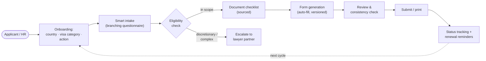

# Torii Platform — Domain Primer

> **Durable doc.** Industry and operational literacy for anyone working on the platform. Read
> [00_overview.md](00_overview.md) first. This doc describes how immigration filing works — not what
> the system must do (that's [02_requirements.md](02_requirements.md)).

## Preparing an immigration filing, as software

An immigration application is a structured, rule-based, well-documented process — which is exactly
why it suits automation and exactly why the margin for error is unforgiving. The core loop is:
**figure out which visa/action applies → confirm the person meets the published eligibility →
gather the required documents → complete the correct government forms, in their current version →
submit and wait**. Each step is governed by official instructions a diligent applicant could read
themselves — the value is doing it accurately, in their language, without 10–20 hours of research or
a $1,500 lawyer for a routine renewal.

Two facts run through everything:

1. **Accuracy is existential.** One wrong date, one missing document, one outdated form version, one
   miscategorized visa type → a rejection. Rejection can mean loss of legal status, employment,
   housing, and the life the applicant built. There is no "roughly right." The product's core
   promise is that the routine parts are done correctly, every time.
2. **The forms have objectively correct answers.** Unlike legal *strategy* (asylum arguments,
   hardship waivers), routine form preparation is verifiable: an output can be checked against the
   official form and its instructions. This is what makes AI tractable here and what makes
   hallucination detectable rather than silent.

## The lane: form preparation, not legal advice

The single most important boundary in the whole domain. In most jurisdictions, giving immigration
*legal advice* for compensation is a licensed activity; helping someone complete government forms
based on their own inputs generally is not. The platform lives entirely on the permitted side.

| PERMITTED (information / form prep) | PROHIBITED (legal advice / representation) |
|---|---|
| Explaining a visa process in general | Advising a specific person on legal strategy |
| Showing which forms a visa type requires | Recommending which visa type a person should pursue |
| Generating pre-filled forms from the user's own inputs | Interpreting how a law applies to the user's specific facts |
| Displaying document checklists from official sources | Advising whether to disclose specific information |
| Linking to official government instructions | Representing the user before immigration authorities |

Positioning is architecture: the product is a **"guided form-preparation tool,"** never an
"advisor"; UI copy and marketing use *information*, *guidance*, *form preparation* — never *advice*;
every instruction is sourced; and when a case needs judgment, the product says so and refers out.

## How a case moves

The operations team keeps the machine honest from behind: they curate the knowledge base of
official sources, author and version form templates and field mappings, encode jurisdiction rules,
run the government-change monitor, and work the human-review queue for cases the system escalates.

## Deterministic rules vs. LLM reasoning

The decision logic is split on purpose, roughly **80% deterministic / 20% LLM**:

- **Rules** (the 80%) — visa-to-forms mapping, eligibility gates, document requirements, form field
  validity. These are derived from official policy manuals and expressed as explicit rules, so their
  output is stable, reviewable, and identical every time. Core correctness never depends on a model
  getting it right on a given run.
- **LLM reasoning** (the 20%) — natural-language intake, plain-language explanation, edge-case
  interpretation, document extraction, translation, and knowing when a case is outside its
  confidence zone. The model *narrates and assists*; it does not *decide* the rule-governed core.

Every instruction the platform emits, whether rule- or model-derived, must carry a citation to its
official source (see [citation-contract.md](citation-contract.md)). If it can't be sourced, it isn't
shown.

## Jurisdictions and the "add a country" shape

Immigration rules are per-country and per-visa-type, and they change without notice. A jurisdiction
is a bundle of: the official source corpus, the visa catalog, eligibility rules, document
requirements, form templates + field mappings, the local UPL/licensing regime, and the language(s).
Adding a country is a **content effort against a stable architecture**, not a re-build. Torii's
beachhead is **Japan** (see below); the same machine then takes the US, Canada, UK, EU, Australia.

## The Japan beachhead

Japan is the recommended starting market and shapes early domain decisions:

- **3.4M+ foreign residents and growing**, driven by labor shortage and new visa categories
  (Specified Skilled Worker, etc.).
- **Forms are complex and primarily in Japanese**; even bilingual applicants struggle. An
  English-language guided tool is near-absent in the market.
- **The 行政書士 (gyōsei-shoshi) regime.** A licensed 行政書士 (Certified Administrative Procedures
  Specialist) is the professional permitted to prepare immigration applications *for compensation*.
  The platform must either partner with licensed 行政書士, obtain that standing, or position strictly
  as a **self-filing aid** where the applicant themselves is the filer. This is the Japan analog of
  the UPL boundary and is a launch gate, not a detail.
- **Government digitization** (the immigration bureau's expanding online application system) creates
  API-friendly endpoints and reduces in-person filing over time.

## Money: how the platform earns

Pricing anchors against the $500–$3,000 lawyer cost, selling the routine work for a fraction:

- **Pay-per-application** (primary) — a flat fee per completed application package; cost aligns with
  value delivered, highest conversion.
- **Annual subscription** (secondary) — unlimited applications for frequent filers (families, serial
  renewers); higher lifetime value through retention.
- **Employer platform** (high ACV) — per-seat / annual license for HR teams managing foreign
  employees: bulk processing, compliance and deadline tracking.
- **Lawyer referral** (ancillary) — referral fees when the platform escalates a complex case to a
  partner; aligns incentives rather than competing.
- **Premium add-ons** (expansion) — document translation, expedited-processing guidance, appointment
  booking, renewal reminders.

A "payment" is not one thing: a single pay-per-app fee, a subscription cycle, or an employer license
are all normal shapes.

## Glossary

| Term | Meaning |
|---|---|
| UPL | Unauthorized Practice of Law — giving legal advice/representation without a license; the boundary the product must never cross. |
| Form preparation | Completing government forms from the user's own inputs; generally permitted, distinct from legal advice. |
| Visa category | The class of visa/status (work, student, dependent, permanent residence, etc.) that determines which forms and rules apply. |
| Action | What the applicant is doing to their status: renewal, change of status, new application, extension. |
| Eligibility gate | A published, rule-expressible condition that must hold for a filing to be valid (e.g. minimum stay, employment continuity). |
| Document checklist | The personalized list of required + recommended documents for a case, each tied to its official source. |
| Field mapping | The pre-validated correspondence between an intake answer and a specific field on a specific government form version. |
| Form version | The dated edition of an official form; filing an outdated version causes automatic rejection — version tracking must be precise. |
| Citation | The official government page / regulation / form-instruction reference backing an instruction the platform shows (see citation-contract). |
| Escalation | Routing a case beyond the platform's scope to a licensed professional (lawyer / 行政書士). |
| RAG | Retrieval-augmented generation — grounding the assistant's answers in the indexed official-source corpus. |
| 行政書士 (gyōsei-shoshi) | Japan's Certified Administrative Procedures Specialist — the licensed preparer of immigration applications for compensation. |
| RCIC | Regulated Canadian Immigration Consultant — Canada's licensed paid-advice role; analog to 行政書士 / a lawyer. |
| Change monitor | The operations process that crawls official sources for form/policy changes and flags them for human review before rules update. |
| Human-review queue | The back-office queue of escalated or low-confidence cases awaiting an operator or partner. |
| Consistency check | The pre-submission pass verifying required fields are filled, names/dates match across documents, and form versions are current. |

## What this doc is NOT

Not a requirements list (02), not an architecture (03), not the startup's market research (that
lives in the founder's evaluation deck). If reality drifts from this primer (a new jurisdiction, a
changed licensing regime, a new payment norm), update it — it should always read true.
