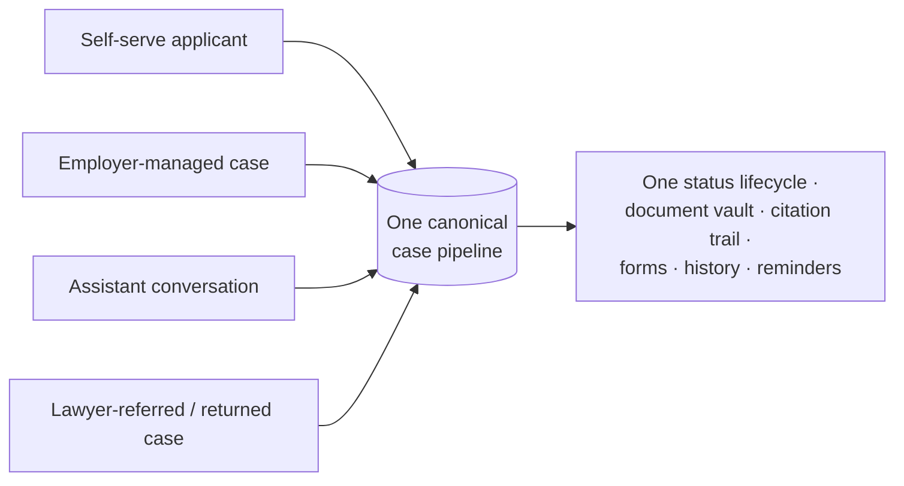

# Torii Platform — Product Requirements (User Stories with EARS Acceptance Criteria)

> **Durable doc — the verifiable contract.** Implementation-agnostic and timeline-agnostic:
> every requirement is testable end-to-end from a user's perspective, regardless of how or when
> it is built. Rewrites, engine swaps, and vendor changes must not invalidate this document.
>
> **Read order:** [00_overview.md](00_overview.md) → [01_domain.md](01_domain.md) → this doc →
> [03_architecture.md](03_architecture.md) → [citation-contract.md](citation-contract.md).

## 1. Scope

This document captures **what the product must do** over its whole lifecycle — independent of
release sequencing or milestones. Phasing (what ships when, which jurisdiction is first) is decided
*from* this spec and recorded in planning artifacts elsewhere; it never changes what is *true* here.

Permanently out of scope of this document: release plans and phase labels; commercial terms and
pricing numbers; specific vendors, models, and frameworks (the providers named in
[01_domain.md](01_domain.md) and [03_architecture.md](03_architecture.md) are context, not
contract); implementation status.

**Not legal advice — by contract.** Nothing in this document may be built in a way that gives
legal advice or represents a user before an authority. The permitted/prohibited boundary in
[01_domain.md](01_domain.md) is binding on every story here; US-12 and US-13 make it enforceable.

## 2. Verification

Kept deliberately lean:

- Story and criterion IDs (`US-NN`, `US-NN.M`) are **stable**. Renumbering is a breaking change.
  New criteria append; retired criteria are struck through, never reused.
- This document **never records status** ("done", "built", "phase 1"). A criterion is met when an
  end-to-end check — automated where the suite exists, scripted/manual until then — exercises it and
  passes. Code existing is not the requirement being met.
- Heavier traceability (criterion-to-test matrices, CI gating by ID) can be layered on later without
  changing this document.

## 3. Personas

| ID | Persona | Description | Goals |
|----|---------|-------------|-------|
| **APP** | Applicant | A foreigner renewing/changing/filing a visa; multilingual, cost-sensitive, deadline-driven, mobile-first, often anxious. | Know exactly which forms and documents are needed, complete them correctly in their own language, avoid a rejection, spend a fraction of a lawyer's fee. |
| **OPS** | Operations / content ops | Keeps the knowledge base, form templates, field mappings, and jurisdiction rules current and correct; works the human-review queue. | Every source current and cited; rule/form changes caught before they cause a rejection; escalations resolved. |
| **EMP** | Employer / HR sponsor | Manages visa cases for a foreign workforce. | Every employee's case and deadline visible at a glance; compliance provable; bulk work not done one-by-one. |
| **LAW** | Immigration lawyer (partner) | Receives escalated complex cases the platform routes out. | A clean stream of qualified, scoped referrals; the routine work already done. |
| **ADM** | Overseer / admin | Owner-level; configures jurisdictions, pricing, roles; approves rule changes before they go live. | The system runs itself within safe legal bounds; nothing needs a developer to reconfigure. |

**The assistant** (the applicant/staff-facing AI) appears in stories by that name: it is a
user-facing actor, not an implementation detail.

## 4. Capability map

User-facing capabilities (not features). Every story maps to one or more:

- **C1 Onboarding & scoping** — narrow to country, visa category, and action; enter the right lane fast.
- **C2 Smart intake** — conversational branching questionnaire that asks only what this case needs; save/resume.
- **C3 Eligibility check** — validate inputs against published eligibility; flag gaps in plain language.
- **C4 Document checklist** — personalized required + recommended documents, each with what/where/why and a source.
- **C5 Form generation** — auto-filled government forms from intake data; visual preview; version-correct.
- **C6 Review & consistency** — pre-submission pass: required fields, cross-document match, current form versions.
- **C7 Submission & output** — downloadable/printable packet for in-person filing, or e-file where supported.
- **C8 Tracking & renewals** — post-submission status, expected timings, reminders for future renewals.
- **C9 Citation & sourcing** — every instruction links to its official government source; unsourced ⇒ not shown.
- **C10 UPL guardrails & escalation** — information-not-advice language; detect out-of-scope cases and refer to a professional.
- **C11 AI assistant** — conversational procedural help grounded in official sources; assists, never advises.
- **C12 Document capture & OCR** — photograph a document, extract fields, reduce re-typing.
- **C13 Multi-language** — every applicant surface in the user's language + the host-country language; plain-language explanations.
- **C14 Knowledge base & change monitoring** — curated official-source corpus, form templates/mappings, government-change detection.
- **C15 Employer platform** — bulk case management, compliance and deadline oversight across a workforce.
- **C16 Payments & packaging** — pay-per-application, subscription, employer license, add-ons.
- **C17 Accounts, consent & privacy** — accounts, sensitive-data handling, explicit consent, export/erase.
- **C18 Analytics & reporting** — case throughput, accuracy/rejection signals, source-freshness, business metrics.

The one-pipeline principle — however a case arrives, it becomes the same kind of case:

## 5. User stories with EARS acceptance criteria

**Discipline.** The story is written in the user's voice: what they want and why — never how the
system delivers it. Anything beyond user pain and goal belongs in the acceptance criteria, which
describe verifiable system behavior.

EARS legend: **Ubiquitous** `THE SYSTEM SHALL …` · **Event** `WHEN <trigger>, THE SYSTEM SHALL …` ·
**Unwanted** `IF <condition>, THEN THE SYSTEM SHALL …` · **State** `WHILE <state>, THE SYSTEM
SHALL …` · **Optional** `WHERE <feature/condition>, THE SYSTEM SHALL …`

---

### US-01 — Scope my case to the right lane
**Personas:** APP · **Capabilities:** C1

**User Story.** As an **applicant**, I want to pick my country, my visa category, and what I'm trying to do — renew, change status, or apply new — so that the platform narrows to exactly my situation instead of drowning me in every rule that could ever apply.

**Why this matters.** Government websites scatter instructions across dozens of pages in bureaucratic language; even a bilingual applicant can't tell which forms are theirs. Narrowing scope up front is what turns an overwhelming problem into a guided path.

| ID | Criterion |
|----|-----------|
| US-01.1 | **WHEN** an applicant begins, **THE SYSTEM SHALL** let them select a country/jurisdiction, a visa category, and an action (renewal, status change, extension, new application). |
| US-01.2 | **WHEN** the applicant has chosen country, category, and action, **THE SYSTEM SHALL** confine the rest of the flow — intake, eligibility, checklist, and forms — to that scope. |
| US-01.3 | **THE SYSTEM SHALL** offer only the jurisdictions, categories, and actions that are configured and live, and **SHALL NOT** present an unsupported combination as available. |
| US-01.4 | **IF** the applicant's situation falls outside every supported combination, **THEN THE SYSTEM SHALL** say so plainly and offer to notify them or refer them onward, rather than start a flow it cannot complete. |

### US-02 — Be guided through a smart, branching intake
**Personas:** APP · **Capabilities:** C2

**User Story.** As an **applicant**, I want a conversational questionnaire that adapts to my answers and asks only what my case needs, so that I'm not filling irrelevant fields or guessing which questions apply to me.

**Why this matters.** Self-filing burns 10–20 hours largely on figuring out what's relevant. A branching intake that hides what doesn't apply — and explains what it asks — removes most of that.

| ID | Criterion |
|----|-----------|
| US-02.1 | **THE SYSTEM SHALL** collect the applicant's case details through a guided questionnaire, presenting questions in plain language. |
| US-02.2 | **WHEN** an answer makes later questions relevant or irrelevant, **THE SYSTEM SHALL** reveal or hide those questions accordingly, so the applicant is only asked what their case requires. |
| US-02.3 | **WHEN** the applicant provides an answer, **THE SYSTEM SHALL** validate it against the expected format/range and prompt for correction before proceeding. |
| US-02.4 | **THE SYSTEM SHALL** show the applicant their progress through the intake and let them go back and change earlier answers. |
| US-02.5 | **WHEN** an earlier answer is changed such that later answers no longer apply, **THE SYSTEM SHALL** re-evaluate the branch and clear or re-ask affected questions. |

### US-03 — Save my case and come back to it
**Personas:** APP · **Capabilities:** C2, C17

**User Story.** As an **applicant**, I want my progress saved so I can stop and resume across devices, because gathering documents and details takes days, not one sitting.

**Why this matters.** An immigration filing spans document-gathering over days. A flow that loses progress on close forces re-entry of sensitive data and drives abandonment.

| ID | Criterion |
|----|-----------|
| US-03.1 | **THE SYSTEM SHALL** persist an applicant's case progress so it can be resumed later. |
| US-03.2 | **WHEN** an applicant returns to a saved case, **THE SYSTEM SHALL** restore their answers, uploaded documents, and position in the flow. |
| US-03.3 | **WHERE** an applicant is signed in on another device, **THE SYSTEM SHALL** make their in-progress case available there. |
| US-03.4 | **THE SYSTEM SHALL** let an applicant maintain more than one case at a time (e.g. their own and a dependent's) without the cases interfering. |

### US-04 — Check whether I'm eligible before I invest effort
**Personas:** APP · **Capabilities:** C3

**User Story.** As an **applicant**, I want the platform to check my answers against the published eligibility criteria and warn me about problems, so that I find out about a gap now rather than after a rejection.

**Why this matters.** A single disqualifier — an employment gap, an expired passport, a missed residency threshold — can sink an application. Surfacing it against the official criteria, early and in plain language, is a core part of pricing the risk of a mistake down.

| ID | Criterion |
|----|-----------|
| US-04.1 | **WHEN** the applicant has provided enough intake data, **THE SYSTEM SHALL** evaluate it against the jurisdiction's published eligibility criteria for the selected visa and action. |
| US-04.2 | **WHEN** an eligibility criterion is not met or is at risk, **THE SYSTEM SHALL** flag it, explain the issue in plain language, and cite the official source of the criterion. |
| US-04.3 | **THE SYSTEM SHALL** present eligibility results as information about the published rules, and **SHALL NOT** advise the applicant on what to do about a gap beyond pointing to official guidance or offering escalation (US-13). |
| US-04.4 | **IF** an eligibility question requires legal judgment rather than a rule check, **THEN THE SYSTEM SHALL** mark it as out of scope and offer escalation to a professional rather than resolve it. |

### US-05 — Get a personalized document checklist
**Personas:** APP · **Capabilities:** C4

**User Story.** As an **applicant**, I want a checklist of exactly the documents my case needs — what each is, where to get it, and why it's required — so that I gather the right paperwork once instead of discovering a missing document at submission.

**Why this matters.** Not knowing which documents apply is one of the biggest sources of delay and rejection. A personalized, sourced checklist replaces the guesswork a lawyer would otherwise be paid for.

| ID | Criterion |
|----|-----------|
| US-05.1 | **WHEN** intake is sufficiently complete, **THE SYSTEM SHALL** generate a checklist of the required and recommended documents for the applicant's specific case. |
| US-05.2 | **THE SYSTEM SHALL** show, for each checklist item, what the document is, where/how to obtain it, and why it is required, with a citation to its official source. |
| US-05.3 | **THE SYSTEM SHALL** distinguish required documents from recommended ones. |
| US-05.4 | **WHEN** an applicant marks a document as gathered or uploads it, **THE SYSTEM SHALL** update the checklist's completion state. |
| US-05.5 | **IF** the case changes such that a document is no longer needed or a new one becomes required, **THEN THE SYSTEM SHALL** update the checklist accordingly. |

### US-06 — Capture a document by photographing it
**Personas:** APP · **Capabilities:** C12

**User Story.** As an **applicant**, I want to photograph my passport, residence card, or employment contract and have the details read off automatically, so that I don't hand-type long numbers and dates and introduce errors.

**Why this matters.** Applicants are mobile-first and their documents are physical. Camera capture with extraction is a killer feature — it reduces both effort and the transcription mistakes that cause rejections.

| ID | Criterion |
|----|-----------|
| US-06.1 | **WHEN** an applicant photographs or uploads a supported document, **THE SYSTEM SHALL** attempt to extract its relevant fields and pre-fill the corresponding intake answers. |
| US-06.2 | **THE SYSTEM SHALL** present every extracted value for the applicant to review and correct before it is used, and **SHALL NOT** treat an extracted value as confirmed without that review. |
| US-06.3 | **IF** extraction confidence is low or the document is unreadable, **THEN THE SYSTEM SHALL** ask the applicant to re-capture or enter the details manually. |
| US-06.4 | **THE SYSTEM SHALL** store the captured document against the case in the document vault (US-05.4, US-21). |

### US-07 — Get my government forms auto-filled
**Personas:** APP · **Capabilities:** C5

**User Story.** As an **applicant**, I want the platform to fill the actual government forms from what I've already entered, and show me a preview of each filled form, so that I get submission-ready paperwork without copying my answers onto official forms by hand.

**Why this matters.** Constrained form generation is what AI does well and what applicants dread. A visual preview of the real form, populated, is the difference between trusting the output and re-checking every field against a PDF.

| ID | Criterion |
|----|-----------|
| US-07.1 | **WHEN** the required intake data for a form is present, **THE SYSTEM SHALL** generate that government form populated with the applicant's data. |
| US-07.2 | **THE SYSTEM SHALL** show a visual preview of each generated form with all populated fields visible, and let the applicant review and edit any field before use. |
| US-07.3 | **THE SYSTEM SHALL** map intake answers to form fields using a pre-validated field mapping for the specific form and its version, and **SHALL NOT** place a value in a field for which no validated mapping exists. |
| US-07.4 | **IF** a required field cannot be populated from available data, **THEN THE SYSTEM SHALL** mark it as needing input rather than leave it silently blank or guess it. |
| US-07.5 | **THE SYSTEM SHALL** cite, for each generated form, the official form and instructions it corresponds to (US-11). |

### US-08 — Never be given an outdated form
**Personas:** APP, OPS · **Capabilities:** C5, C14

**User Story.** As an **applicant**, I want to be certain the forms I'm filing are the current official versions, because filing an outdated form is an automatic rejection.

**Why this matters.** Governments revise forms without warning; a stale version is rejected regardless of content. Version currency is not a nicety — it's a correctness guarantee the platform lives or dies on.

| ID | Criterion |
|----|-----------|
| US-08.1 | **THE SYSTEM SHALL** track the official version of every form it generates and record which version was used on each generated document. |
| US-08.2 | **WHEN** a form is generated, **THE SYSTEM SHALL** use the version currently marked live for that jurisdiction. |
| US-08.3 | **IF** a form's official version has changed since a case's forms were generated, **THEN THE SYSTEM SHALL** flag the affected case and prompt regeneration before submission. |
| US-08.4 | **IF** the current official version of a required form cannot be confirmed, **THEN THE SYSTEM SHALL** withhold generation of that form and surface the case for operations review rather than emit a possibly-stale form. |

### US-09 — Have my packet checked before I submit
**Personas:** APP · **Capabilities:** C6

**User Story.** As an **applicant**, I want a final check that all required fields are filled, my name and dates match across every document, and my form versions are current, so that I catch a mistake before the government does.

**Why this matters.** Most rejections are avoidable clerical errors — a mismatched name, a blank required field, a wrong date. A consistency pass across the whole packet is the last line of defense the applicant is paying for.

| ID | Criterion |
|----|-----------|
| US-09.1 | **WHEN** an applicant requests a review, **THE SYSTEM SHALL** verify that every required field across the packet's forms is populated and report any that are missing. |
| US-09.2 | **THE SYSTEM SHALL** cross-check values that must agree across documents (e.g. name spelling, passport number, dates) and flag any mismatch. |
| US-09.3 | **THE SYSTEM SHALL** verify each form in the packet is the current official version (US-08) and flag any that are not. |
| US-09.4 | **WHILE** the packet has unresolved review flags, **THE SYSTEM SHALL** let the applicant proceed to submission only after acknowledging them, and **SHALL** make the flags visible up to that point. |
| US-09.5 | **THE SYSTEM SHALL** present review as a factual consistency check of the applicant's own inputs against form requirements, not as advice on the merits of the application. |

### US-10 — Get a submission-ready packet
**Personas:** APP · **Capabilities:** C7

**User Story.** As an **applicant**, I want to download or print my completed forms and checklist as one packet, and e-file where that's supported, so that I can submit the way my situation requires without re-assembling anything.

**Why this matters.** Filing is still often in-person or by mail; sometimes online. The applicant needs the finished work in the shape their office actually accepts, cleanly assembled.

| ID | Criterion |
|----|-----------|
| US-10.1 | **WHEN** an applicant completes review, **THE SYSTEM SHALL** produce the completed forms as a downloadable, printable packet. |
| US-10.2 | **THE SYSTEM SHALL** include the personalized document checklist with the packet so the applicant knows what to bring or attach. |
| US-10.3 | **WHERE** a jurisdiction supports electronic submission and it is enabled, **THE SYSTEM SHALL** let the applicant submit electronically and record the submission reference. |
| US-10.4 | **THE SYSTEM SHALL** make the final submitted packet retrievable from the applicant's case history afterward. |

### US-11 — See the official source behind every instruction
**Personas:** APP · **Capabilities:** C9

**User Story.** As an **applicant**, I want every requirement, form, and instruction to link to the official government page it came from, so that I can verify the platform is right and trust it over a lawyer's unexplained assurance.

**Why this matters.** Transparency is the single strongest trust-builder and the backbone of the legal positioning. Most lawyers are black boxes; a platform that shows *why* each thing is required, from the source, earns trust a black box can't — and keeps the product on the information side of the UPL line. See [citation-contract.md](citation-contract.md).

| ID | Criterion |
|----|-----------|
| US-11.1 | **THE SYSTEM SHALL** attach to every instruction, required form, document requirement, and eligibility statement it presents a citation to the specific official government source it derives from. |
| US-11.2 | **WHEN** an applicant opens a citation, **THE SYSTEM SHALL** identify the source (page/regulation/form-instruction) and let them reach it. |
| US-11.3 | **IF** an instruction cannot be tied to an official source, **THEN THE SYSTEM SHALL NOT** present it. |
| US-11.4 | **THE SYSTEM SHALL** record, for each citation shown, the source version/retrieval date so a later source change is detectable (US-26). |

### US-12 — Be helped, not advised
**Personas:** APP, ADM · **Capabilities:** C10

**User Story.** As an **applicant**, I want the platform to help me prepare my own forms without pretending to be my lawyer, so that I get real help while staying clearly on the safe, legal side of what a tool is allowed to do.

**Why this matters.** UPL enforcement is the platform's existential risk. Positioning as a guided form-preparation tool — never an advisor — is what makes the whole business legally viable. This must be enforced in the product, not just the marketing.

| ID | Criterion |
|----|-----------|
| US-12.1 | **THE SYSTEM SHALL** present itself throughout as a guided form-preparation tool that helps users complete their own filings, and **SHALL NOT** describe itself as providing legal advice or representation. |
| US-12.2 | **THE SYSTEM SHALL** frame its outputs as information, guidance, and form preparation, and **SHALL NOT** tell a specific applicant which visa or legal strategy to choose, or interpret how a law applies to their specific facts. |
| US-12.3 | **THE SYSTEM SHALL** confirm the applicant is the filer of their own application (self-filing), or route the filing through a licensed professional where the jurisdiction requires one (US-13, and the 行政書士 gate in [01_domain.md](01_domain.md)). |
| US-12.4 | **THE SYSTEM SHALL** present its scope and its limits to the applicant, including that it does not provide legal advice. |
| US-12.5 | **WHERE** a jurisdiction's licensing regime constrains what the platform may do, **THE SYSTEM SHALL** apply that jurisdiction's constraints to what it offers there. |

### US-13 — Be routed to a professional when my case needs one
**Personas:** APP, LAW · **Capabilities:** C10

**User Story.** As an **applicant**, I want the platform to tell me clearly when my case is beyond what a tool should handle and connect me to a qualified professional, so that I don't get a routine tool's answer to a situation that needs real legal judgment.

**Why this matters.** Discretionary decisions, appeals, complex petitions, and deportation defense require counsel. Building the escalation path is ethically correct, legally protective, and a revenue channel — and it makes the routine-work promise credible by being honest about its edge.

| ID | Criterion |
|----|-----------|
| US-13.1 | **WHEN** a case involves a matter the platform classifies as out of scope (e.g. asylum, hardship waiver, criminal inadmissibility, appeals/litigation, complex employer petitions, removal proceedings), **THE SYSTEM SHALL** detect it and inform the applicant that professional help is appropriate. |
| US-13.2 | **WHEN** the platform escalates, **THE SYSTEM SHALL** offer the applicant a path to a licensed professional / partner and hand over the relevant case context with the applicant's consent. |
| US-13.3 | **IF** the assistant cannot answer a question within scope with confidence, **THEN THE SYSTEM SHALL** escalate rather than guess (see US-15). |
| US-13.4 | **THE SYSTEM SHALL** record each escalation, its reason, and its outcome against the case. |
| US-13.5 | **WHERE** a case is escalated, **THE SYSTEM SHALL** preserve the work already done so the professional (or the applicant on return) does not start over. |

### US-14 — Ask the assistant procedural questions
**Personas:** APP · **Capabilities:** C11

**User Story.** As an **applicant**, I want to ask the assistant questions about my process in my own words and get clear answers, so that I can resolve confusion without waiting for or paying a person.

**Why this matters.** Applicants have constant "what does this mean / what do I do next" questions. An assistant that answers instantly, in their language, from official sources, turns anxiety into progress and is the conversational face of the whole product.

| ID | Criterion |
|----|-----------|
| US-14.1 | **THE SYSTEM SHALL** let an applicant ask the assistant questions about their process, forms, documents, and timelines in natural language. |
| US-14.2 | **WHEN** the applicant asks a procedural question, **THE SYSTEM SHALL** answer using the official-source knowledge base and cite the source(s) (US-11). |
| US-14.3 | **WHEN** answering about the applicant's own case, **THE SYSTEM SHALL** use the case's own data and context. |
| US-14.4 | **WHILE** in a conversation, **THE SYSTEM SHALL** retain the context of what was already discussed within that case. |

### US-15 — Trust that the assistant won't make things up or overstep
**Personas:** APP · **Capabilities:** C11, C9, C10

**User Story.** As an **applicant**, I want the assistant to answer only from official sources and to refuse rather than guess or give legal advice, so that I can rely on what it tells me about a high-stakes process.

**Why this matters.** One confidently-wrong answer on a visa question destroys trust permanently and could cause real harm. The assistant's discipline — grounded, cited, scope-aware — is what separates this from a generic chatbot and keeps it inside the legal lane.

| ID | Criterion |
|----|-----------|
| US-15.1 | **THE SYSTEM SHALL** ground the assistant's answers in the official-source knowledge base and **SHALL NOT** present unsourced claims as fact. |
| US-15.2 | **IF** the assistant cannot answer confidently from sourced material, **THEN THE SYSTEM SHALL** say so and offer escalation (US-13) rather than fabricate an answer. |
| US-15.3 | **WHEN** a question calls for legal advice or case-specific legal interpretation, **THE SYSTEM SHALL** decline to advise and explain that it provides information, not advice (US-12). |
| US-15.4 | **THE SYSTEM SHALL** answer within the applicant's selected jurisdiction scope and not apply another jurisdiction's rules to their case. |

### US-16 — Use the platform in my own language
**Personas:** APP · **Capabilities:** C13

**User Story.** As an **applicant**, I want every part of the platform available in my language as well as the host country's, so that I understand what I'm filing and don't mistranslate something critical.

**Why this matters.** Applicants are multilingual and the host-country forms are in the host language. Bureaucratic Japanese (or any local language) is exactly the barrier the product removes; that only works if the interface itself meets the applicant in their language.

| ID | Criterion |
|----|-----------|
| US-16.1 | **THE SYSTEM SHALL** present every applicant-facing surface — intake, checklist, explanations, assistant, notifications — in the applicant's chosen language and in the host country's language. |
| US-16.2 | **WHEN** an applicant writes to the assistant in a supported language, **THE SYSTEM SHALL** reply in that language. |
| US-16.3 | **WHERE** a form must be filed in the host-country language, **THE SYSTEM SHALL** still show the applicant an explanation of each field in their chosen language while keeping the filed value in the required language. |

### US-17 — Have bureaucratic language explained plainly
**Personas:** APP · **Capabilities:** C13

**User Story.** As an **applicant**, I want official jargon translated into plain language with the exact official term shown alongside, so that I know what I'm being asked without misunderstanding a legal term.

**Why this matters.** "Submit Certificate of Eligibility per Immigration Control Act Art. 7-1-2" means nothing to most people; "Upload the Certificate of Eligibility your employer received from immigration" does. Plain language reduces error and anxiety — while keeping the official term visible preserves accuracy.

| ID | Criterion |
|----|-----------|
| US-17.1 | **THE SYSTEM SHALL** present official/legal terms with a plain-language explanation. |
| US-17.2 | **WHEN** it simplifies an official term, **THE SYSTEM SHALL** keep the exact official term available so nothing is lost in translation. |
| US-17.3 | **THE SYSTEM SHALL** derive plain-language explanations from official sources and cite them (US-11) rather than invent meanings. |

### US-18 — Track my submission
**Personas:** APP · **Capabilities:** C8

**User Story.** As an **applicant**, I want to see where my submitted application stands and what to expect next, so that I'm not left in the dark during weeks of processing on something this consequential.

**Why this matters.** Post-submission silence is its own source of anxiety. A dashboard of status, expected timing, and next steps reassures the applicant and reduces "where is my application" support load.

| ID | Criterion |
|----|-----------|
| US-18.1 | **THE SYSTEM SHALL** show the applicant the current status of each of their cases. |
| US-18.2 | **THE SYSTEM SHALL** present, for a submitted case, the expected processing time and what happens next, from official guidance where available. |
| US-18.3 | **WHEN** a case's status changes, **THE SYSTEM SHALL** reflect the new status wherever the applicant views the case. |
| US-18.4 | **WHERE** a jurisdiction exposes an official status lookup, **THE SYSTEM SHALL** let the applicant reach or reflect that status. |

### US-19 — Be reminded before my next deadline
**Personas:** APP · **Capabilities:** C8

**User Story.** As an **applicant**, I want to be reminded well before my visa needs renewing, so that I never miss a hard deadline whose consequences are severe.

**Why this matters.** Renewals recur every 1–3 years and the deadlines are unforgiving. Proactive reminders turn a one-time filing into a recurring relationship and protect the applicant from the worst outcome — an accidental lapse in status.

| ID | Criterion |
|----|-----------|
| US-19.1 | **THE SYSTEM SHALL** record the relevant expiry/renewal date for a completed case. |
| US-19.2 | **WHEN** a recorded renewal date approaches within a configured lead time, **THE SYSTEM SHALL** remind the applicant through their chosen channel. |
| US-19.3 | **WHEN** an applicant acts on a renewal reminder, **THE SYSTEM SHALL** start a new case pre-filled from the prior case's still-valid data (US-03, US-07). |
| US-19.4 | **THE SYSTEM SHALL** only send reminders and other non-transactional messages to applicants who have consented to receive them (US-21). |

### US-20 — Have an account and my case history
**Personas:** APP · **Capabilities:** C17

**User Story.** As an **applicant**, I want an account that keeps my cases, documents, and history in one place, so that renewals and future filings reuse what I've already provided instead of starting from scratch.

**Why this matters.** Recurring renewals and family filings make continuity valuable. An account that remembers a person turns each subsequent filing into minutes rather than hours and is the basis of retention and lifetime value.

| ID | Criterion |
|----|-----------|
| US-20.1 | **WHEN** a visitor chooses to register, **THE SYSTEM SHALL** let them create an account and later sign in to it. |
| US-20.2 | **WHEN** a signed-in applicant opens their account, **THE SYSTEM SHALL** show their cases with each case's current status and their stored documents. |
| US-20.3 | **THE SYSTEM SHALL** let an applicant reuse still-valid data and documents from a prior case in a new one. |
| US-20.4 | **THE SYSTEM SHALL** authenticate applicants securely and protect access to their cases and documents. |

### US-21 — Control my personal and immigration data
**Personas:** APP · **Capabilities:** C17

**User Story.** As an **applicant**, I want clear control and protection over the sensitive personal and immigration data I hand over, so that I can trust a platform I'm giving my passport, employment, and immigration history to.

**Why this matters.** Immigration data is among the most sensitive a person holds, and the applicants are, by definition, people whose standing in a country depends on it. Strong consent, protection, and control are both a legal requirement and a precondition for trust.

| ID | Criterion |
|----|-----------|
| US-21.1 | **THE SYSTEM SHALL** obtain the applicant's explicit consent for processing their personal data, recording data-processing consent separately from any marketing/communication consent. |
| US-21.2 | **THE SYSTEM SHALL** protect applicant documents and personal data with encryption in transit and at rest and restrict access to authorized parties. |
| US-21.3 | **WHEN** an applicant requests a copy of their data, **THE SYSTEM SHALL** provide it in a portable form. |
| US-21.4 | **WHEN** an applicant requests deletion of their data, **THE SYSTEM SHALL** erase it subject to any record-keeping the law requires, and confirm what was done. |
| US-21.5 | **THE SYSTEM SHALL** disclose to whom a case's data is shared (e.g. a professional on escalation, US-13.2) and share it only with the applicant's consent. |

### US-22 — Pay for a completed application
**Personas:** APP · **Capabilities:** C16

**User Story.** As an **applicant**, I want to pay a clear, fair price for my completed application package — far less than a lawyer — so that the value is obvious and the cost is predictable.

**Why this matters.** The 10x cost advantage is the wedge. Pricing anchored against the lawyer cost and aligned with a completed package (rather than an opaque hourly bill) is what drives conversion.

| ID | Criterion |
|----|-----------|
| US-22.1 | **THE SYSTEM SHALL** show the applicant the price of their application package before they commit to pay. |
| US-22.2 | **WHEN** an applicant pays, **THE SYSTEM SHALL** confirm the payment and unlock the paid outputs (e.g. the final packet / e-file) for that case. |
| US-22.3 | **WHERE** a subscription or employer license applies, **THE SYSTEM SHALL** grant the corresponding access without a per-application charge. |
| US-22.4 | **WHERE** premium add-ons are offered (e.g. translation, expedited guidance, appointment booking), **THE SYSTEM SHALL** let the applicant purchase them per case. |
| US-22.5 | **IF** a payment fails or is not completed, **THEN THE SYSTEM SHALL** leave the case's paid outputs locked and let the applicant retry. |

### US-23 — Manage my workforce's cases in bulk (employer)
**Personas:** EMP · **Capabilities:** C15

**User Story.** As an **HR sponsor**, I want to manage many employees' visa cases from one dashboard, so that I can run a foreign workforce's immigration without handling each person as a separate, manual project.

**Why this matters.** The employer platform is the path to enterprise-scale, high-ACV revenue and a B2B2C flywheel — each employer brings many applicant users. Bulk management is what makes it worth an HR team's while.

| ID | Criterion |
|----|-----------|
| US-23.1 | **THE SYSTEM SHALL** let an employer see all their employees' cases in one place with each case's status and owner. |
| US-23.2 | **THE SYSTEM SHALL** let an employer initiate and manage cases on behalf of employees, with each case joining the same canonical case pipeline as self-serve cases. |
| US-23.3 | **THE SYSTEM SHALL** let an employer collect the employee's own inputs and consent for a case rather than fill sensitive personal data on the employee's behalf without it. |
| US-23.4 | **THE SYSTEM SHALL** support acting on multiple cases together where the action is common (e.g. initiating renewals for a cohort with upcoming expiries). |

### US-24 — See compliance and deadlines across my workforce (employer)
**Personas:** EMP · **Capabilities:** C15, C8

**User Story.** As an **HR sponsor**, I want visibility of every employee's visa validity and upcoming deadlines, so that no one's status lapses on my watch and I can prove compliance.

**Why this matters.** For employers, a lapsed employee visa is a compliance and business risk. Deadline oversight across the workforce is the core value the employer platform sells.

| ID | Criterion |
|----|-----------|
| US-24.1 | **THE SYSTEM SHALL** show an employer each employee's current visa validity and next renewal/expiry deadline. |
| US-24.2 | **WHEN** an employee's deadline approaches within a configured lead time, **THE SYSTEM SHALL** alert the employer. |
| US-24.3 | **THE SYSTEM SHALL** let an employer see, at a glance, which cases are on track, at risk, or overdue. |
| US-24.4 | **THE SYSTEM SHALL** let an employer export a compliance view of their workforce's immigration status. |

### US-25 — Curate the official-source knowledge base (ops)
**Personas:** OPS · **Capabilities:** C14, C9

**User Story.** As an **operations specialist**, I want to maintain the corpus of official sources the platform reasons and cites from, so that every answer and instruction stays grounded in current, correct government material.

**Why this matters.** The knowledge base is the product's factual foundation and its legal cover. Keeping it curated, current, and attributable is what makes both citation (US-11) and grounded assistance (US-15) trustworthy.

| ID | Criterion |
|----|-----------|
| US-25.1 | **THE SYSTEM SHALL** let an operations specialist add, update, and retire official-source material in the knowledge base, each item attributed to its official origin. |
| US-25.2 | **WHEN** knowledge-base material changes, **THE SYSTEM SHALL** use the updated material in later answers, checklists, and citations. |
| US-25.3 | **THE SYSTEM SHALL** record the origin and retrieval/version date of each source item so citations can reference it (US-11.4). |
| US-25.4 | **THE SYSTEM SHALL** require that source material be from an official government origin before it can back a customer-facing instruction. |

### US-26 — Catch government changes before they cause a rejection (ops)
**Personas:** OPS · **Capabilities:** C14

**User Story.** As an **operations specialist**, I want to be alerted when a government source, form, or policy we depend on changes, so that I can review and update our rules before an applicant files something outdated.

**Why this matters.** Immigration agencies update forms and policies without warning; a stale rule silently produces rejections. Automated change detection with human review before anything goes live is the operational backbone of the accuracy promise.

| ID | Criterion |
|----|-----------|
| US-26.1 | **THE SYSTEM SHALL** monitor the official sources it depends on for changes and flag detected changes for review. |
| US-26.2 | **WHEN** a change is detected in a source, form, or policy, **THE SYSTEM SHALL** surface it to operations with what changed, and **SHALL NOT** silently alter live rules or forms from it. |
| US-26.3 | **THE SYSTEM SHALL** require human review and approval before a detected change updates a live rule, form version, or citation. |
| US-26.4 | **WHILE** a depended-upon form or rule is flagged as changed and unreviewed, **THE SYSTEM SHALL** treat the affected forms as at-risk for generation (US-08.3, US-08.4). |

### US-27 — Work the human-review and escalation queue (ops / lawyer)
**Personas:** OPS, LAW · **Capabilities:** C10, C14

**User Story.** As an **operations specialist or partner lawyer**, I want a queue of the cases the platform escalated or couldn't resolve, with their full context, so that a human handles what a tool shouldn't.

**Why this matters.** Escalation (US-13) and low-confidence stops (US-15) are only trustworthy if a human actually picks them up. The review queue is where the platform's honesty about its limits becomes a real service.

| ID | Criterion |
|----|-----------|
| US-27.1 | **THE SYSTEM SHALL** place every escalated or low-confidence case into a review queue with the reason and the case context. |
| US-27.2 | **WHEN** an authorized reviewer opens a queued case, **THE SYSTEM SHALL** show them the case's inputs, generated work, and escalation reason. |
| US-27.3 | **WHEN** a reviewer resolves a queued case, **THE SYSTEM SHALL** record the resolution and reflect it in the case history and to the applicant. |
| US-27.4 | **THE SYSTEM SHALL** limit access to queued cases and their data to authorized reviewers (US-30, US-21). |

### US-28 — Author form templates and field mappings (ops)
**Personas:** OPS · **Capabilities:** C5, C14

**User Story.** As an **operations specialist**, I want to define each government form's template and how intake answers map onto its fields, so that form generation stays accurate and updatable without a developer for every change.

**Why this matters.** Forms and their field layouts change per version and per jurisdiction. Making templates and mappings first-class, editable content — not code — is what lets the platform keep pace with government changes and scale across countries as a content effort.

| ID | Criterion |
|----|-----------|
| US-28.1 | **THE SYSTEM SHALL** let an operations specialist define a form template tied to a specific form and version and the pre-validated mapping from intake data to its fields. |
| US-28.2 | **WHEN** a mapping is published, **THE SYSTEM SHALL** use it for generating that form version (US-07.3). |
| US-28.3 | **THE SYSTEM SHALL** let operations mark a form version as live, superseded, or draft, and generate only from a live version (US-08.2). |
| US-28.4 | **THE SYSTEM SHALL** validate a form template/mapping against test inputs before it can be marked live. |

### US-29 — Configure a jurisdiction (admin)
**Personas:** ADM, OPS · **Capabilities:** C1, C14

**User Story.** As an **overseer**, I want to configure a country/jurisdiction — its visa categories, eligibility rules, document requirements, forms, licensing constraints, and languages — so that we can open a new market as a content and configuration effort, not a rebuild.

**Why this matters.** Adding a country is the platform's growth motion. Treating a jurisdiction as configuration over a stable architecture is what makes multi-country expansion tractable and defensible.

| ID | Criterion |
|----|-----------|
| US-29.1 | **THE SYSTEM SHALL** let an administrator define a jurisdiction's visa categories, actions, eligibility rules, document requirements, forms, and supported languages. |
| US-29.2 | **THE SYSTEM SHALL** let an administrator record a jurisdiction's licensing/UPL constraints and apply them to what the platform offers there (US-12.5). |
| US-29.3 | **WHEN** a jurisdiction is marked live, **THE SYSTEM SHALL** offer it in onboarding (US-01); **WHILE** it is not live, **THE SYSTEM SHALL** withhold it from applicants. |
| US-29.4 | **THE SYSTEM SHALL** keep jurisdictions independent, so a change to one does not alter another. |

### US-30 — Staff roles and scoped access (admin)
**Personas:** ADM · **Capabilities:** C17

**User Story.** As an **overseer**, I want to grant each team member and partner access to only what their job needs, so that operations, admins, and partner lawyers each work within safe limits over highly sensitive data.

**Why this matters.** The team spans operations, admins, and external partners touching sensitive immigration data. Configurable, least-privilege roles — not baked-in job titles — let access be granted and revoked safely as the team and partnerships change.

| ID | Criterion |
|----|-----------|
| US-30.1 | **THE SYSTEM SHALL** let an administrator define roles and assign each a set of permissions over back-office, employer, and review functions. |
| US-30.2 | **WHEN** a role is assigned, **THE SYSTEM SHALL** limit that member's access to only the functions and data their role permits. |
| US-30.3 | **IF** a member attempts an action outside their role, **THEN THE SYSTEM SHALL** refuse it. |
| US-30.4 | **THE SYSTEM SHALL** let an administrator change or revoke a role at any time, effective on the member's next actions. |
| US-30.5 | **THE SYSTEM SHALL** record who accessed or changed sensitive case data and when. |

### US-31 — See how the platform and the business are doing (admin / employer)
**Personas:** ADM, EMP · **Capabilities:** C18

**User Story.** As an **overseer**, I want reporting on case throughput, accuracy signals, source freshness, and business metrics, so that I can run the platform on evidence — especially the accuracy and freshness numbers that the whole promise rests on.

**Why this matters.** Accuracy and source-currency are the product's core risk; conversion and retention are its business. Making both visible lets the team invest where it matters — disproportionately in validation and data freshness.

| ID | Criterion |
|----|-----------|
| US-31.1 | **THE SYSTEM SHALL** report case throughput — cases started, completed, submitted, and escalated — over a selectable date range. |
| US-31.2 | **THE SYSTEM SHALL** report accuracy-related signals available to it (e.g. review-flag rates, regeneration due to version changes, reported rejections where known). |
| US-31.3 | **THE SYSTEM SHALL** report source-freshness — sources/forms flagged as changed and awaiting review, and how long they have waited (US-26). |
| US-31.4 | **THE SYSTEM SHALL** report business metrics (conversion to paid, subscription/employer coverage, escalation/referral volume). |
| US-31.5 | **WHERE** a role or an employer's scope limits access, **THE SYSTEM SHALL** show only the reports permitted, and an employer only their own workforce. |

---

## 6. Cross-cutting (non-functional) requirements

| ID | Requirement |
|----|-------------|
| NF-1 | **Accuracy first.** THE SYSTEM SHALL derive rule-governed outputs (visa-to-forms, eligibility, document requirements, field mappings) from deterministic, reviewable rules rather than model inference, so core correctness does not depend on a model's run; LLM reasoning assists and narrates but does not decide the rule-governed core. |
| NF-2 | **Sourced or silent.** THE SYSTEM SHALL NOT present any customer-facing instruction, requirement, or form that is not traceable to an official government source (US-11, citation-contract). |
| NF-3 | **On the information side of the line.** THE SYSTEM SHALL be built and worded so that no feature gives legal advice or represents a user before an authority, in every jurisdiction it operates (US-12, US-13). |
| NF-4 | **Sensitive-data protection & residency.** THE SYSTEM SHALL encrypt personal and immigration data in transit and at rest, enforce least-privilege access server-side, honor consent, export, and erasure (US-21), and process data in the jurisdiction/region the applicable law requires. |
| NF-5 | **Multilingual by default.** THE SYSTEM SHALL present every applicant-facing surface in the applicant's language and the host-country language, with translated content localizable per language (US-16, US-17). |
| NF-6 | **Case integrity.** THE SYSTEM SHALL NOT lose or duplicate a case or a submitted packet across any channel; every status, payment, escalation, and sensitive-data access transition SHALL be recorded with actor and time. |
| NF-7 | **Reach & performance.** Applicant surfaces SHALL be mobile-first and remain usable on low-end devices and constrained networks; interactive steps SHALL respond without perceptible wait on typical mobile connections. |
| NF-8 | **Adding a jurisdiction is content, not rebuild.** THE SYSTEM SHALL let a new jurisdiction be added by configuration and content (sources, rules, forms, mappings, languages, licensing) without re-architecting (US-29). |
| NF-9 | **Human-in-the-loop for changes.** THE SYSTEM SHALL require human review before a detected government change alters a live rule, form version, or citation (US-26). |
| NF-10 | **Anti-abuse.** Public forms, sign-up, and messaging surfaces SHALL be protected against automated/bot submission without adding friction for legitimate applicants. |

## 7. Open product decisions

Unresolved product questions. Each is recorded here until decided; deciding one updates the affected
stories by appending criteria — never by renumbering.

1. **Product name.** "Torii" is a working codename; the real name is the founder's call (affects
   nothing here but naming across surfaces).
2. **Japan filing standing.** Whether to partner with licensed 行政書士, obtain that standing, or
   position strictly as a self-filing aid — the Japan launch gate (US-12.3, [01_domain.md](01_domain.md)).
3. **Beachhead scope.** Which visa category/action to launch first within Japan (e.g. work-visa
   renewal) before broadening (US-01, US-29).
4. **Out-of-scope taxonomy.** The concrete list of case types that trigger escalation, per
   jurisdiction (US-13.1) — qualitative here until legal review confirms each market's line.
5. **Accuracy bar & measurement.** The target accuracy threshold and how rejections are detected and
   attributed (US-31.2) — the number the whole promise is measured against.
6. **Pricing.** Concrete pay-per-application, subscription, employer-license, and add-on prices
   (US-22 requires the mechanism; the numbers are configuration).
7. **Lawyer-partner model.** How partners are onboarded, matched, and compensated on referral
   (US-13, US-27).
8. **E-filing integrations.** Which jurisdictions' electronic-submission systems to integrate versus
   produce print/mail packets for (US-10.3).
9. **Retention windows for erasure.** Legal record-keeping obligations that bound data erasure per
   jurisdiction (US-21.4).
