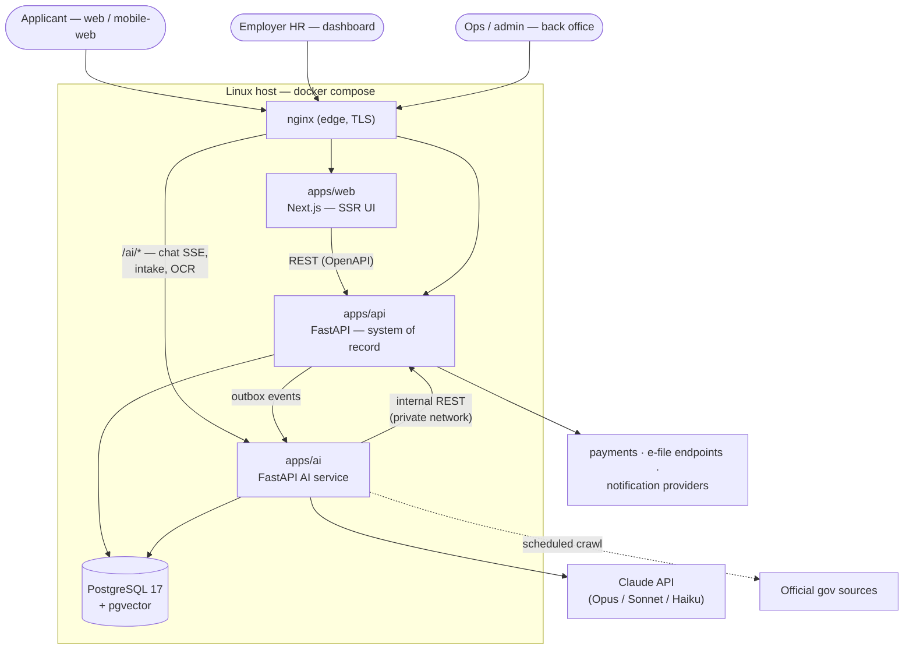

# Torii Platform — Architecture

> **One proposed realization.** This document is subordinate to
> [02_requirements.md](02_requirements.md): it describes *a* way to build the product, not what the
> product is. Engine swaps, framework changes, or service reshuffles that keep the requirements true
> do not require changing 00–02. The stack below (FastAPI + Next.js + Claude) is a choice, not a
> contract.

## Shape

One monorepo, one PostgreSQL database (with pgvector), one Linux host to start — a few cooperating
services behind a single edge (nginx):

```
apps/
  api/        FastAPI (Python 3.12) — the system of record: users, cases, jurisdictions,
              visa/eligibility rules, forms & field mappings, documents, payments, audit
  ai/         FastAPI (Python 3.12) — the AI service: intake orchestration, RAG over the
              official-source corpus, form-fill, citation engine, guardrails, OCR, assistant
  web/        Next.js (App Router, TS) — applicant app + employer dashboard + ops/admin back
              office (multilingual, mobile-first, server-rendered)
packages/     shared types / generated API client (OpenAPI → TS + Python)
infra/        compose, nginx, deploy, backups
docs/         this documentation
```



**`apps/api` is the single source of business truth.** Users and accounts, jurisdictions and their
visa/eligibility/document rules, the canonical case pipeline and status lifecycle, form definitions
and versioned field mappings, the document vault, payments and entitlements, employer orgs, the
review/escalation queue, roles/authz, and the immutable audit log. Every case channel — self-serve,
employer-managed, assistant-driven, lawyer-returned — converges here into one case model. Rule
evaluation (visa→forms, eligibility gates, document requirements) is deterministic and lives here,
not in the model (NF-1).

**`apps/ai`** is the model-facing service: it runs the conversational intake, retrieves over the
official-source corpus (RAG on pgvector), fills forms from a case's data using the API's validated
field mappings, enforces the citation contract and UPL guardrails, does document OCR/extraction, and
serves the assistant. It **decides nothing rule-governed** — it calls the API for rules and case
data and returns narration, drafts, and citations for the API to persist.

**`apps/web`** renders the applicant app, the employer dashboard, and the ops/admin back office off
the same API, server-rendered for reach and SEO, mobile-first, and multilingual via locale routing.

## Why this split (and why two FastAPI services)

The API is request/response, transactional, and the legal system of record — it must be boring,
correct, and auditable. The AI service is long-running, model-latency-bound, prompt-iterative, and
ships on its own cadence (prompt/model changes shouldn't touch the money-and-forms service). Keeping
them separate means: model outages never take down case/payment integrity; the AI service can never
write a rule-governed fact directly (it must go through the API, which validates); and the audit
story stays clean. Both are FastAPI so the team runs one language and one toolchain.

## The AI service

```
ai/
  intake/     conversational branching intake; asks the API which questions this scope needs,
              collects answers, validates, returns structured case data to the API
  rag/        retrieval over the official-source corpus (pgvector); returns passages + source refs
  forms/      form-fill: takes case data + the API's validated field mapping, produces the
              populated form and the per-field source refs; never invents a field value
  citations/  the citation engine — every emitted instruction carries a source ref or is dropped
              (see citation-contract.md)
  guardrails/ UPL/scope classifier + language policy: information-not-advice, escalate-not-guess
  ocr/        document capture → field extraction → confidence; hands values back for user review
  assistant/  the conversational agent (grounded, cited, scope-aware) over web (and later chat)
  monitor/    scheduled crawl of official sources; diff detection → flags for human review (never
              writes live rules)
```

Model tiering (default to the latest, most capable Claude models; tier by task):

- **Opus** — hard reasoning: edge-case intake interpretation, escalation classification, the
  consistency/review pass.
- **Sonnet** — the everyday assistant, plain-language explanation, translation.
- **Haiku** — cheap high-volume work: classification, extraction post-processing, routing.

LLM inference is low cost per session; the real operating cost is content maintenance and human
review (NF-9), which is where the ops tooling and the change monitor earn their place.

## Integration seams

Three seams between the API and the AI service:

1. **AI → API (sync reads/writes):** REST over the private network, service-token authed. The AI
   service reads jurisdiction rules, eligibility gates, field mappings, and case data, and writes
   *proposals* (structured intake data, generated-form artifacts, draft answers) that the API
   validates and persists. Business logic and rule evaluation stay single-sourced in the API — the
   AI service never touches store tables directly and never decides a rule-governed fact (NF-1).
2. **API → AI (async events):** an **outbox table** in PostgreSQL — the API writes events
   (renewal-due, source-changed-needs-embedding, case-escalated, form-version-changed) in the same
   transaction as the business change; an AI worker polls and processes (at-least-once, survives
   restarts). Swappable for a queue later without touching domain code.
3. **Inbound:** nginx routes `/ai/*` (chat SSE, intake steps, OCR upload) to the AI service and
   everything else to `web`/`api`. The assistant streams replies over SSE-over-POST (see
   [citation-contract.md](citation-contract.md) for the wire shape and the citation payload).

A case in motion — guided filing with a mid-flow escalation:

```mermaid
sequenceDiagram
    participant U as Applicant (web)
    participant AI as apps/ai
    participant API as apps/api — system of record
    U->>AI: start intake (scope: JP · work visa · renewal)
    AI->>API: which questions for this scope?
    API-->>AI: branch definition + eligibility rules
    AI->>U: guided questions (plain language, cited)
    U->>AI: answers (+ photographed residence card)
    AI->>AI: OCR extract → user confirms values
    AI->>API: submit structured case data
    API->>API: evaluate eligibility (deterministic rules)
    API-->>AI: eligible; required forms + validated field mappings
    AI->>API: generated forms + per-field source refs
    Note over API: consistency check + version currency
    alt case flagged out-of-scope by guardrails
        AI->>API: escalate (reason, context)
        API-->>U: professional referral (consent to hand over)
    else in scope
        API-->>U: review-ready packet (every item cited)
    end
```

The AI service owns its schema (conversations, knowledge chunks, embeddings, OCR artifacts) in the
same PostgreSQL (pgvector); the API owns cases, forms, payments, and the outbox.

## Cross-cutting choices

- **Data:** PostgreSQL for everything; per-service schemas; vector search in-database (pgvector).
  Documents/media in object storage with references in the DB; encrypted at rest (NF-4).
- **Rules engine:** deterministic rule evaluation in `apps/api` (visa→forms, eligibility gates,
  document requirements) — data-driven and reviewable, not code-per-jurisdiction. This is the 80% of
  [01_domain.md](01_domain.md); the model is the 20% (NF-1).
- **Citation engine:** a first-class component in `apps/ai` — no customer-facing instruction leaves
  without a source ref, or it is dropped (NF-2; [citation-contract.md](citation-contract.md)).
- **Guardrails:** a scope/UPL classifier and a language policy gate every applicant-facing output —
  information-not-advice wording, escalate-not-guess on low confidence (NF-3, US-12/13/15).
- **Forms:** form templates + versioned, pre-validated field mappings are content owned by ops
  (US-28), stored in the API; generation fills only mapped fields and stamps the version used (US-08).
- **Change monitor:** `apps/ai/monitor` crawls official sources on a schedule, diffs, and writes
  *flags* to the API's review queue — it never mutates a live rule or form (NF-9, US-26).
- **i18n:** applicant language + host-country language are content-model concerns (localized fields)
  and UI concerns (Next.js locale routing), not an afterthought (NF-5).
- **Payments:** gateway integrations behind one entitlement model that also represents subscription
  and employer-license access; paid outputs are gated on entitlement, not on a per-request check in
  the UI (US-22).
- **Notifications:** one dispatch abstraction over the messaging/email providers, driven by
  case-pipeline events (renewal reminders, status changes), templated per language and consent (US-19, US-21).
- **Security & privacy:** OWASP basics as a floor; server-side least-privilege authz on every
  back-office/employer capability; secrets in a secret store (never in code or prompts); consent
  tracked (processing separately from marketing); export/erase honored; region-pinned processing for
  data residency (NF-4).
- **Audit:** every status, payment, escalation, and sensitive-data access recorded with actor and
  time in an append-only log (NF-6, US-30.5).
- **Deploy:** docker-compose behind nginx on one host; TLS; scheduled DB + document backups; scale
  by promoting services (especially `apps/ai`) onto their own hosts, not by rewriting.
